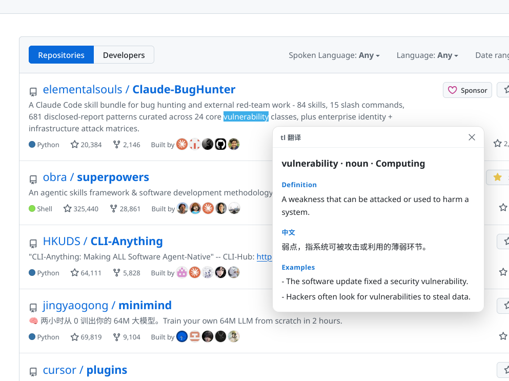

# tl

`tl` is a small terminal tool for learning English vocabulary and translating between English and Chinese. It uses any OpenAI-compatible Chat Completions API and keeps the terminal experience intentionally simple.

## Features

- Look up a single English word and get its part of speech, a simple English definition, a Chinese meaning, and two natural examples.
- Translate English sentences or paragraphs into Chinese, and Chinese text into English.
- Automatically choose vocabulary mode for one English word and translation mode for everything else.
- Play a five-minute roguelike vocabulary raid with `tl --game`.
- Read TOML configuration with environment variable overrides.
- Keep normal lookup and translation output non-interactive, with no history or favorites.

## Firefox Extension

A companion Firefox add-on translates selected text directly on the page. Select text with the mouse, click the floating **译** button, and the result appears in a compact popup.

<p align="center">
  
</p>

Features:

- **English → Chinese**: select an English sentence or paragraph.
- **Chinese → English**: select Chinese text.
- **Single English word**: shows the same dictionary layout as the CLI, including part of speech, definition, Chinese meaning, and two examples.
- Uses the configured OpenAI-compatible endpoint, model, timeout, and non-thinking mode.
- The API key stays in Firefox extension local storage and is never exposed to web pages.

Install the development build:

1. Open Firefox and navigate to `about:debugging#/runtime/this-firefox`.
2. Click **Load Temporary Add-on**.
3. Select `firefox-extension/manifest.json` from this repository.
4. Open the extension settings and enter your API key. The default endpoint is `https://aiping.cn/api/v1`, the default model is `Qwen3.5-9B`, and thinking mode is disabled.
5. Select English or Chinese text on any page and click the **译** button.

See [firefox-extension/README.md](firefox-extension/README.md) for more details.

## Installation

Build from source:

```bash
git clone https://github.com/yuxialuozi/tl.git
cd tl
make build
./bin/tl --help
```

To install with Go after the repository is published:

```bash
go install github.com/yuxialuozi/tl/cmd/tl@latest
```

## Configuration

The default configuration path is:

```text
~/.config/tl/config.toml
```

Copy the example and edit it:

```bash
mkdir -p ~/.config/tl
cp configs/config.example.toml ~/.config/tl/config.toml
```

```toml
[provider]
base_url = "https://api.example.com/v1"
api_key = ""
model = "YOUR_MODEL"

[app]
timeout = 30
enable_thinking = false
```

The endpoint must expose the OpenAI-compatible `POST /chat/completions` API. `base_url` normally includes the version prefix, for example `https://api.openai.com/v1`.

Set `enable_thinking = false` to send `enable_thinking: false` with each request. This is useful for Qwen models that support a non-thinking mode. Leave it unset to use the provider default.

API key environment variables are preferred:

```bash
export TL_API_KEY="your-key"
export TL_BASE_URL="https://api.example.com/v1"
export TL_MODEL="your-model"
```

Configuration priority is:

```text
environment variables > config file > defaults
```

`tl config` shows the configuration path, file status, endpoint, model, timeout, and whether an API key is configured. It never prints the API key.

## Usage

Look up one English word:

```bash
tl keyring
```

Translate an English sentence:

```bash
tl "The daemon runs in the background."
```

Translate Chinese text:

```bash
tl "守护进程在后台运行。"
```

Show configuration status:

```bash
tl config
```

Show the version:

```bash
tl version
```

Start the five-minute vocabulary raid with the `--game` flag:

```bash
tl --game
```

The game runs entirely offline in the terminal with Bubble Tea, and its colors adapt to light and dark terminal themes.

Gameplay:

- Choose a CET-4, CET-6, or TOEFL wordbook.
- Explore a randomly generated dungeon with the arrow keys or `WASD`.
- Walk over `?` tiles to collect weapons, accessories, consumables, and passive upgrades.
- Monsters patrol the map. Walking into a monster, or letting one reach you, starts a four-choice vocabulary battle.
- Answer correctly to attack. Wrong answers can trigger counterattacks, and combo damage grows with consecutive correct answers.
- Defeat the multi-phase Boss before the five-minute timer expires.

Monsters:

- `s` Slime: does not counterattack.
- `k` Skeleton: counterattacks after a wrong answer.
- `g` Gargoyle: requires two consecutive correct answers to break its ward.
- `B` Boss: gains extra wards and stronger counterattacks as its health crosses phase thresholds.

Items are split into consumables, weapons, accessories, and passive effects. Every defeated monster drops one random item, with drop rarity weighted at common, rare, and epic tiers.

Controls:

```text
Arrows / WASD     Move and explore
Enter             Start a run or restart
A-D / 1-4         Answer during combat
H                 Use a health potion (restore 30 HP)
F                 Use a focus potion (double the next correct hit)
X                 Use a bomb (35 direct damage)
R                 Use a warding scroll (absorb the next wrong-answer hit)
Q                 Quit
```

Text containing spaces must be quoted. `tl` accepts exactly one input string, and `config` and `version` are reserved command names.

## Development

Requirements:

- Go 1.23 or newer
- make

Common commands:

```bash
make build
make test
make lint
make clean
```

`make test` runs unit tests with mock HTTP servers and never calls a real API. `make lint` runs `go vet ./...`.

For a release build, pass a version explicitly:

```bash
make build VERSION=0.1.0
```

The version is embedded with linker flags, so future GitHub Release builds can use the same Makefile without changing the source.

## Project Layout

```text
cmd/tl/               CLI entry point
internal/cli/         Cobra command wiring
internal/config/      TOML loading, environment overrides, validation
internal/llm/         OpenAI-compatible HTTP client
internal/translator/  mode detection, prompts, JSON parsing
internal/renderer/    Lipgloss and plain-text output
internal/game/        Bubble Tea vocabulary raid game
configs/              example configuration
firefox-extension/    Firefox selection translator
docs/images/          documentation screenshots
```

## License

MIT
