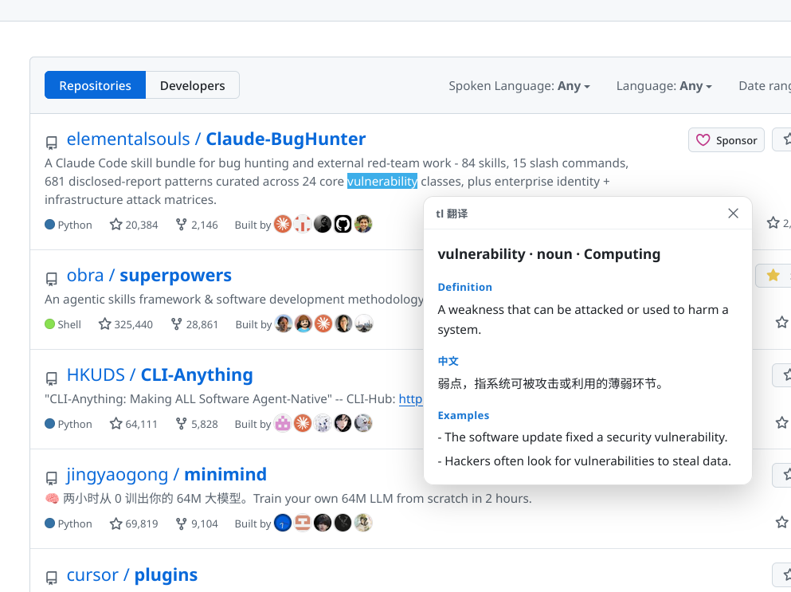

# tl Firefox extension

A small Firefox add-on for translating selected English or Chinese text with the same OpenAI-compatible endpoint used by the `tl` CLI.

<p align="center">
  
</p>

## Features

- Select text on any page to show a small floating **译** button.
- Click the button to translate in place.
- A single English word uses the dictionary layout: word, part of speech, definition, Chinese meaning, and two examples.
- Bidirectional translation: English sentences become Chinese, and Chinese text becomes English.
- The popup title shows the active direction, such as `English → 中文` or `中文 → English`.
- Translation runs in the extension background, so the API key is not exposed to web pages.
- Uses structured JSON output and the same translation prompt as `tl`.

## Install for development

1. Open Firefox and navigate to `about:debugging#/runtime/this-firefox`.
2. Click **Load Temporary Add-on**.
3. Select `firefox-extension/manifest.json`.
4. Open the extension settings and enter your API key.

The temporary add-on is removed when Firefox restarts. Reload it from the same page after restarting.

## Default configuration

The settings page starts with the current `tl` configuration:

```text
Base URL: https://aiping.cn/api/v1
Model: Qwen3.5-9B
Timeout: 120 seconds
Thinking mode: disabled
```

No API key is bundled in the extension. Enter it once in the settings page; it is stored only in Firefox extension local storage. Changing the endpoint to a different host will ask Firefox for permission to access that host.

When you click the translation button, the selected text is sent to the configured API endpoint. The API key is sent only as the authentication header for that request. The extension declares Firefox data collection categories `websiteContent` and `authenticationInfo` for this reason.

## Usage

English to Chinese:

1. Select an English sentence or paragraph.
2. Click the **译** button and read the Chinese result.

Chinese to English:

1. Select Chinese text such as `守护进程在后台运行。`.
2. Click the **译** button. The result is `The daemon runs in the background.`.

Single English word:

1. Select a word such as `vulnerability`.
2. Click the **译** button to see its word, part of speech, definition, Chinese meaning, and examples.

Only translation mode is used. The extension does not add history, favorites, a sidebar, or a full-page immersive translation mode.

## Files

```text
manifest.json   Firefox extension manifest
defaults.js     default endpoint and model settings
background.js   settings, API request, JSON parsing
content.js      selection detection and floating translation card
options.html    settings interface
options.js      settings persistence and host permissions
options.css     settings styling
```
